# Secure Drone Command Link: Hybrid RSA + AES-GCM Encryption over FHSS LoRa

Real-time **MAVLink drone commands** (ARM, DISARM, GUIDED, TAKEOFF, LAND, motor test) sent over a **LoRa radio link built on a USRP software-defined radio**. The link uses frequency hopping and is protected end to end by a **hybrid RSA-2048 (OAEP) + AES-256-GCM** encryption pipeline with **replay-attack protection**.

Work carried out at **TiHAN, IIT Hyderabad**, as part of an FHSS-based anti-jamming system for secure UAV communication.

<p align="center">
  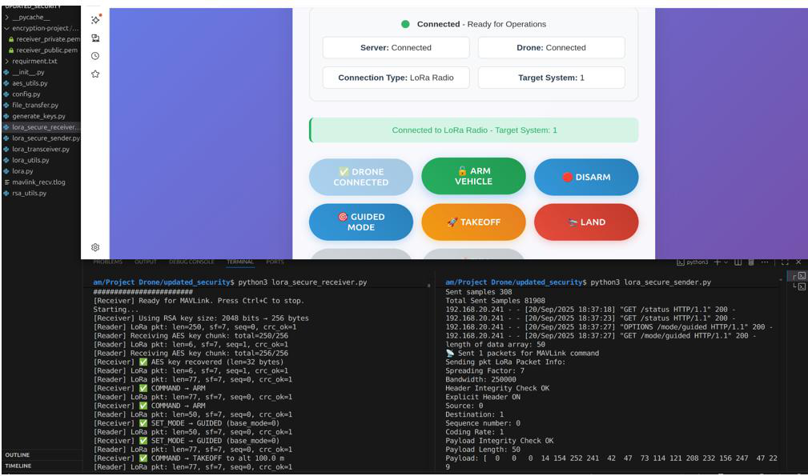
  <br><em>The ground-station dashboard sends ARM / GUIDED / TAKEOFF commands. The receiver (left terminal) recovers the AES key with RSA and decrypts each MAVLink command over LoRa.</em>
</p>

## Highlights

| | |
|---|---|
| 🔐 **Encryption** | AES-256-GCM per packet. The session key is wrapped with RSA-2048 PKCS#1-OAEP. |
| ✅ **Integrity** | The 16-byte GCM authentication tag is verified before any plaintext is used, so tampered packets are dropped. |
| 🔁 **Replay protection** | Two layers: SHA-256 / sequence deduplication for LoRa retransmissions, plus nonce-timing replay detection |
| 📡 **Anti-jamming** | FHSS LoRa link with synchronised Tx/Rx hopping |
| ⏱️ **Latency** | About **150–200 ms** end to end (command → encrypt → LoRa → decrypt → execute) |
| 🎯 **Reliability** | **100% decryption success** across the packets tested. Commands executed correctly on a CubePilot (ArduPilot). |

## How it works

<p align="center">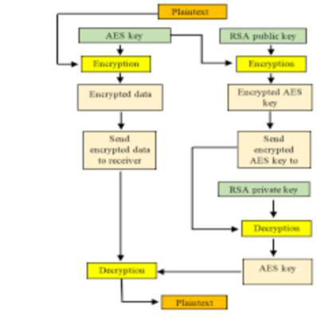</p>

1. **Key generation:** the receiver (drone) creates an RSA-2048 key pair (`generate_keys.py`). Only the **public** key is copied to the sender (ground station).
2. **Session key:** the sender generates a fresh **AES-256 key** for the session, encrypts it with RSA-OAEP using the receiver's public key, and sends the 256-byte result in **LoRa-sized chunks** (header `0xA1`).
3. **Commands:** each MAVLink command is packed with `pymavlink`, encrypted with AES-GCM and sent as a single packet (header `0xB1`):

   ```
   0xB1 | ciphertext length (4 B) | NONCE (16 B) | TAG (16 B) | CIPHERTEXT
   ```
4. **Receiver:** reassembles the key chunks and decrypts the AES key with its **private** key. For each command packet it verifies the GCM tag, decrypts the payload and parses the MAVLink message (`COMMAND → ARM`, `SET_MODE → GUIDED`, …).

The work progressed in three tasks:

| Task | What | Figures |
|---|---|---|
| **1. Hybrid pipeline** | Manual version (`.enc` + RSA-wrapped `.bin` key copied by hand) → automatic LoRa-integrated version with chunking | [manual vs automatic](docs/figures/05_manual_vs_automatic_pipeline.png), [output](docs/figures/07_task1_hybrid_pipeline_output.png) |
| **2. Duplex link** | Ground station ↔ drone, with an independent AES session key in each direction, so compromising one direction's key does not expose the other | [duplex model](docs/figures/08_duplex_model.png), [key exchange output](docs/figures/09_task2_key_exchange_output.png) |
| **3. AES-128 vs AES-256** | Key size made configurable (10 vs 14 rounds). AES-128 was slightly faster, but AES-256 was kept as the default because the extra cost is small within the 150–200 ms budget. | [AES-128 workflow](docs/figures/11_aes128_workflow.png) |

<p align="center">
  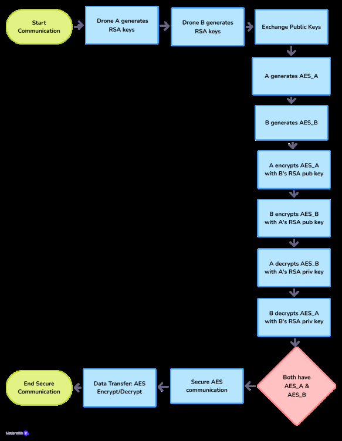
  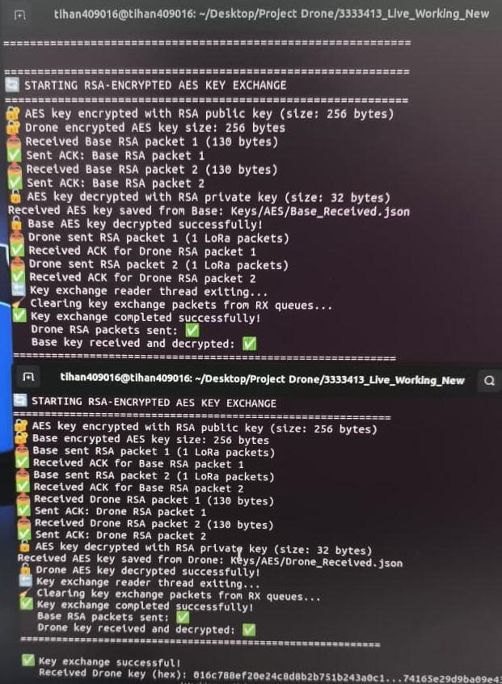
</p>

## Replay-attack protection

Testing on real hardware showed that **LoRa retransmissions deliver the same encrypted packet 2–3 times**. A naive nonce check flagged these legitimate duplicates as attacks, so the protection was split into two layers:

- **Layer 1, radio deduplication:** identical packets (SHA-256 hash or sequence + payload) seen again within a short window are dropped silently.
- **Layer 2, nonce replay detection:** an old or reused AES-GCM nonce, together with a sequence number inside the encrypted payload, is flagged as a **genuine replay**. The packet is rejected before decryption and the event is logged.

<p align="center">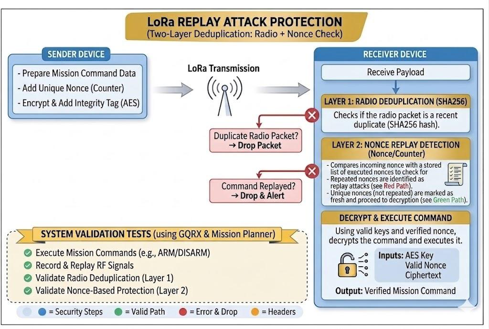</p>

**Intruder experiment:** a third SDR acted as an attacker. It captured a live encrypted command off the air with **GQRX** and re-transmitted it at the receiver.

<p align="center">
  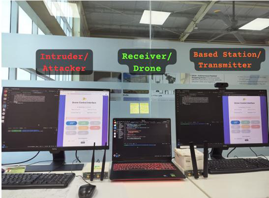
  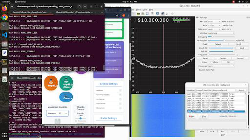
</p>

| Normal encrypted command | Captured and replayed packet |
|---|---|
| 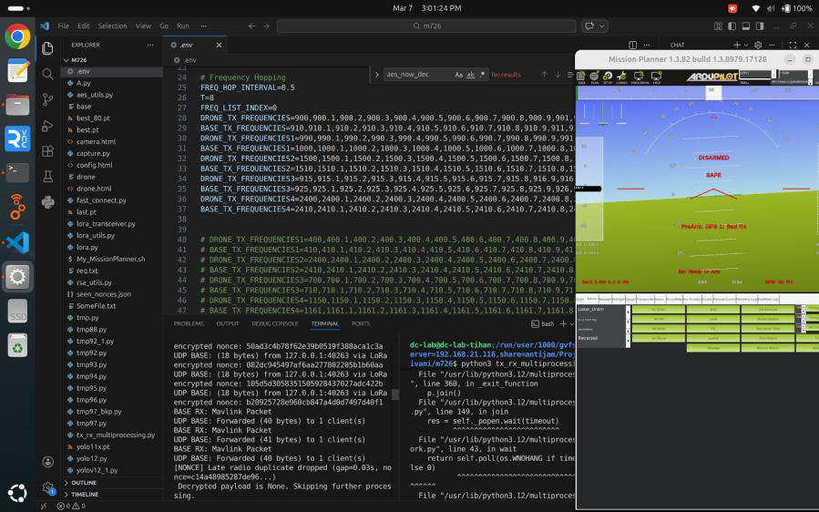 | 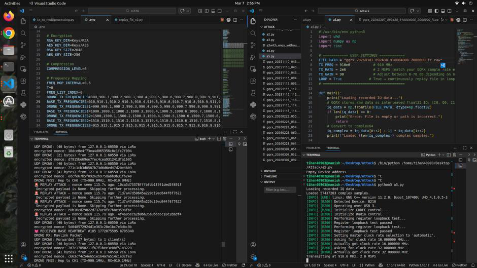 |

**Results**

- Duplicates inside the deduplication window (< 3 s) were dropped with no false alerts.
- Replays (nonce reused after > 10 s) were detected and rejected.
- Each command executed **exactly once**, even with LoRa-level retransmissions.
- The replay from the independent intruder SDR was also rejected.

## System overview

<p align="center">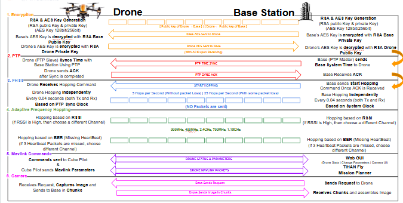</p>
<p align="center">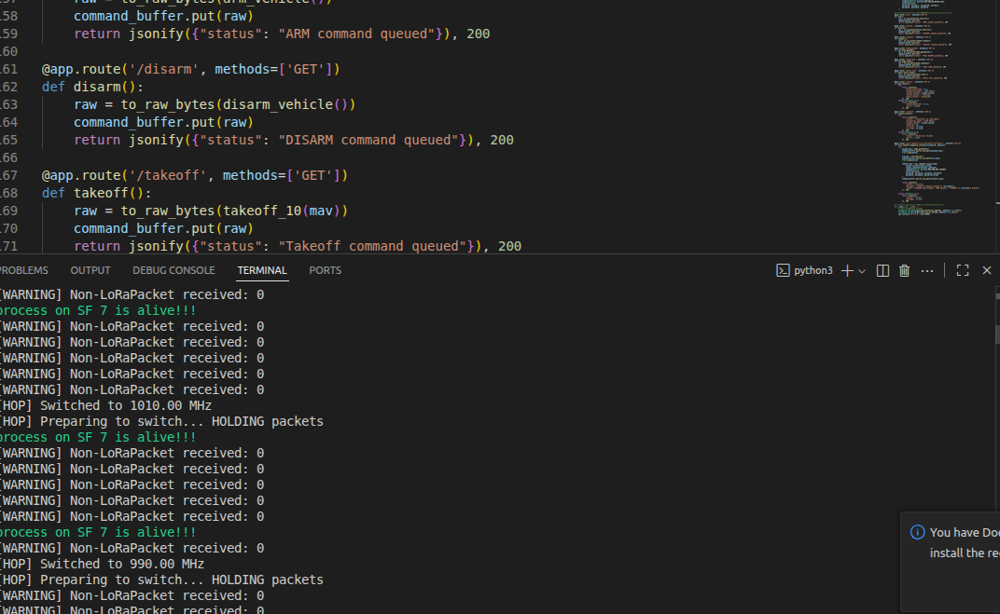</p>

## Repository layout

```
lora_secure_sender.py      ground station: RSA-wraps the AES key, AES-GCM encrypts MAVLink commands,
                           Flask API (:5000) for the dashboard (/arm, /disarm, /takeoff, /mode/guided, /mode/land, /motor_test)
lora_secure_sender1.py     same sender with verbose debug output (nonce, tag, ciphertext lengths)
lora_secure_receiver.py    drone side: reassembles the key, RSA-decrypts it, verifies + decrypts commands, deduplicates packets
aes_utils.py               AES-GCM key generation, encrypt / decrypt
rsa_utils.py               RSA-2048 key generation, OAEP encrypt / decrypt, PSS sign / verify
file_transfer.py           Sender / Receiver classes for the hybrid file pipeline (.enc + .bin)
generate_keys.py           creates receiver_private.pem / receiver_public.pem
config.py                  paths, key sizes, LoRa payload size
lora.py, lora_transceiver.py, lora_utils.py   LoRa PHY + USRP (UHD) transceiver
encryption-project/src/keys/receiver_public.pem   receiver public key (the private key is NOT in the repo)
docs/figures/              architecture diagrams and recorded test outputs
```

## Running

Hardware: two USRP SDRs (ground station and drone) and a CubePilot / ArduPilot flight controller. Install the UHD Python bindings for your USRP.

```bash
pip install -r requirements.txt

# 1. On the receiver (drone): generate keys, then copy receiver_public.pem to the sender
python generate_keys.py

# 2. Set each script's USRP serial number and Tx/Rx frequencies (the sender transmits at 990 MHz
#    and receives at 1010 MHz; the receiver uses the reverse pair)
python lora_secure_receiver.py      # drone side
python lora_secure_sender.py        # ground station, then send commands from the dashboard or:
curl http://localhost:5000/arm
```

> 🔐 **Private keys are never committed.** `.gitignore` blocks `*private*.pem`, the stored session key `aes_key.json`, and the `.bin`/`.enc`/`.dec` files. Generate your own key pair with `generate_keys.py`.

## Planned improvements

- ECC (X25519 / Ed25519) instead of RSA-2048, giving smaller keys and faster exchange
- Ephemeral ECDHE per session for forward secrecy
- ACK-based retransmission of lost key and data chunks
- Hardware key storage (TPM/HSM) with short-lived session keys

## References

- "Enhancing the Security of the MAVLink with Symmetric Authenticated Encryption for Drones," IEEE, 2024. https://ieeexplore.ieee.org/document/10710297/
- "MAVSec: Securing the MAVLink Protocol for Ardupilot/PX4 Unmanned Aerial Systems," IEEE. https://ieeexplore.ieee.org/document/8766667/
- "Secure Communication System of Drone Service using Hybrid Cryptography over 4G/LTE Network," IEEE. https://ieeexplore.ieee.org/document/9231951/

**Author:** Kolkur Shivani Reddy, TiHAN, IIT Hyderabad. Guided by Dr. P. Rajalakshmi and Dr. Paresh Upadhyay.
